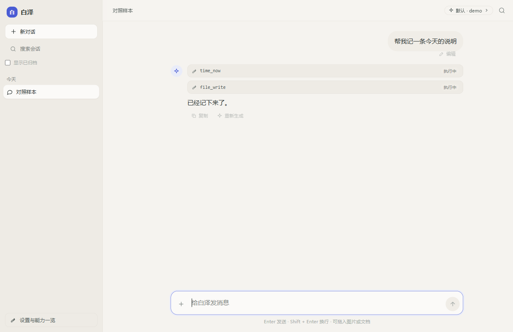
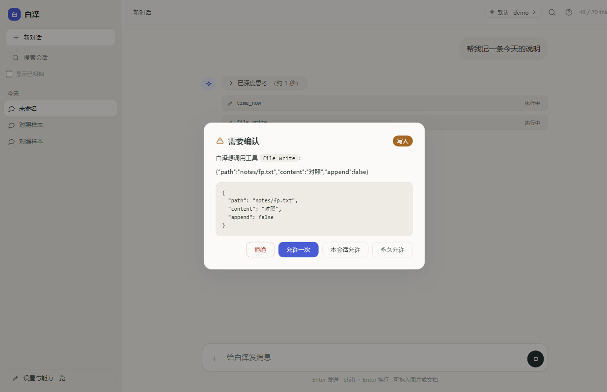
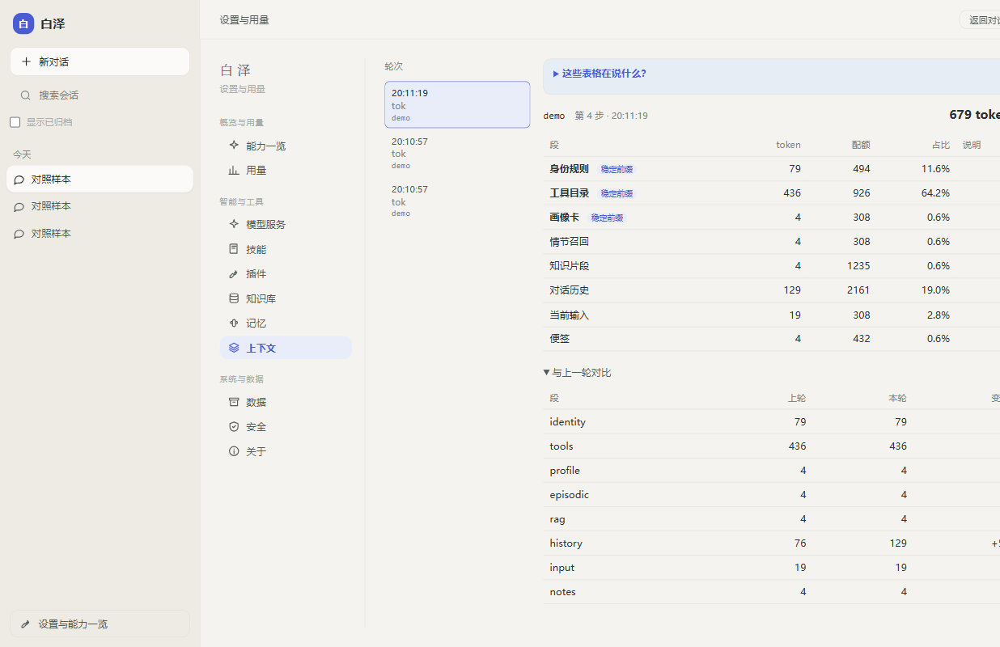
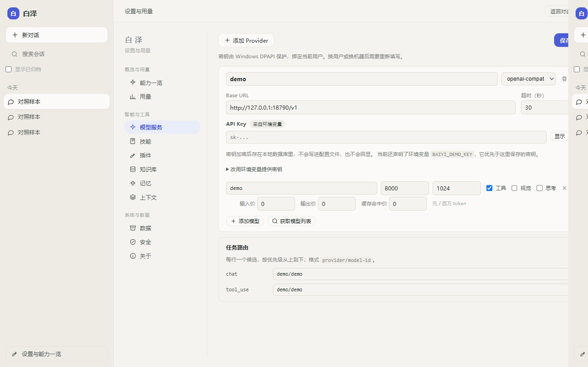

# 白泽 · baiyi-chat

[](https://github.com/lincanyitse/baiyi-chat/actions/workflows/ci.yml)

**Baiyi** is a local-first, single-user AI assistant in one binary. It speaks three model protocols (OpenAI Chat Completions, OpenAI Responses, Anthropic), shows exactly what the model saw each turn, and keeps memory plus a citation-backed knowledge base. The kernel is Go; the interface is Svelte. MIT licensed.

> 一个单用户、本地运行、模型无关的 AI 个人助理。

## 界面










## 亮点

- **一个二进制**：前端打进 Go 程序，`CGO_ENABLED=0` 交叉编译，数据在本机 SQLite
- **三种模型协议**：OpenAI 兼容、Responses、Anthropic，主线路失败自动换下一条
- **上下文可解释**：每一轮记录模型看到了什么、哪一段被裁掉、为什么
- **记忆与知识库**：跨会话记住偏好；导入文档后检索带可点击出处
- **有测试的界面与分层**：33 个前端用例；`scripts/check-layering.sh` 守住包的依赖方向
- **决策写在文档里**：从企划到 ADR，为什么这样做都留着

取名自上古神兽**白泽**——通晓万物之情，能言人语。

**当前状态：内核完备；Web 产品 v0.1–v0.4 全部完成。** 内核（对话、工具、记忆、RAG）已经能用；Web 侧从「能问出第一句话」到「打开界面就知道能做什么」的四段旅程都已走通——见 [路线图](docs/18-Web产品路线图.md)。

## 它能做什么

- **对话**：三种模型协议流式输出，支持思考过程与跨进程续聊
- **调用工具**：时间、技能加载、结构化提问、取回大结果、知识库检索；外加任意 MCP server 的工具
- **多步推理**：一轮内串行或并行调用多个工具，在步数与预算约束内收敛
- **中断续跑**：进程被杀后重启可接着跑，已完成的工具调用不重复执行
- **权限控制**：三级风险分级，危险操作必须终端确认；接触外部内容后永久授权失效
- **上下文可解释**：每轮可查看模型实际看到了什么、哪一段被裁剪、为什么
- **技能**：往 `skills/` 放一个 `SKILL.md` 就生效，无需重新编译
- **故障降级**：主 Provider 挂了自动切次选；嵌入服务挂了检索自动退为关键词
- **知识库**（M2.1）：接入 md/html/txt，结构化切分，向量+关键词混合检索，返回可定位引用
- **记忆**（M2.2）：跨会话记住偏好与身份，画像卡进稳定前缀不破坏缓存，可撤销可溯源

## 直接用

从 [Releases](https://github.com/lincanyitse/baiyi-chat/releases) 下载对应平台的压缩包。解压后里面只有一个可执行文件（Windows 是 `baiyi-windows-amd64.exe`），双击即可运行：

- 会自动启动本地服务并打开浏览器，界面里配置模型服务与密钥
- 再启动一次不会重复开标签页，只在端口变化时打开新页
- 数据（会话、记忆、配置）放在 `%APPDATA%\baiyi`，不写注册表，删目录即卸载

命令行选项：

| 参数 | 作用 |
| --- | --- |
| `baiyi` / `baiyi serve` | 启动 Web 服务（默认） |
| `baiyi repl` | 启动 REPL（调试用） |
| `baiyi reset-password` | 清除 Web 口令，下次打开重新设置 |
| `--listen 127.0.0.1:9000` | 覆盖监听地址 |
| `--data-dir <路径>` | 覆盖数据目录 |
| `--no-open` | 启动时不打开浏览器 |
| `--open` | 强制打开浏览器（即使上次已开过） |

## 从源码构建

需要 Go 1.26 与 Node 18+（前端构建后内嵌进二进制，运行时不需要 Node）：

```bash
make build
./bin/baiyi.exe
```

没有 `make` 时等价的手工命令写在 [Makefile](Makefile) 各 target 的注释里。

**测试**：`make check` 跑 Go 全量测试、vet、格式与分层检查；
`npm --prefix web test` 跑前端 33 个用例（vitest，覆盖 Markdown 安全边界、
状态聚合、导航数据与格式化）。`make build` 在编译前端前会自动跑一遍前端测试。

## REPL

`baiyi repl` 是调试入口，不是产品主界面。输入 `/help` 查看全部命令。几个常用：

| 命令 | 作用 |
| --- | --- |
| `/context` | 看这一轮模型实际收到了什么 |
| `/skills` | 已加载的技能 |
| `/health` | 各 Provider 健康状态 |
| `/resume` | 续跑中断的轮次 |
| `/kb add <路径>` | 把文档加进知识库 |
| `/kb search <关键词>` | 检索知识库 |
| `/kb stats` | 文档数、嵌入模型、检索耗时 |
| `/memory card` | 查看画像卡（模型实际看到的用户信息） |
| `/memory list` | 已记住的事实与确认次数 |
| `/memory why <id>` | 这条记忆哪来的、被确认过几次 |

## 数据

**导出**：左侧会话列表里点导出图标下载 Markdown；「设置 → 数据」可导出全部会话的 JSONL
（保留分支结构，供程序处理）。

**备份**：「设置 → 数据」里点「立即备份」，生成数据库完整快照到 `<数据目录>/backups/`。
用 SQLite 的 `VACUUM INTO`，包含 WAL 中已提交的内容——不会漏掉最近的对话。

**恢复**：先停止白泽，然后

```bash
baiyi restore <备份文件路径>
```

原数据库会被改名保留（`baiyi.db.before-restore-*`，含 `-wal`），恢复错了能换回来。

## 技能与插件

两样都在 Web 界面「设置」里管理，不需要改配置文件或重启。

**技能**：往 `<数据目录>/skills/<名字>/SKILL.md` 放一个 Markdown 文件就多一项能力。
「设置 → 技能」能看到已加载的技能、启用或禁用、重新扫描目录。

**插件（MCP server）**：外部工具服务，支持 stdio（本机命令）与 http（远程地址）。
「设置 → 插件」里增删改，保存即生效，每个 server 的连接状态与工具列表都会显示。
stdio 会在本机执行命令，只添加你信任的 server；写入类操作可以标 `risk` 让它走审批。

## 模型服务与密钥

在 Web 界面的「设置 → 模型服务」里配置，或走首次启动时的向导。密钥有两种来源，**环境变量优先**：

| 来源 | 适合谁 | 说明 |
| --- | --- | --- |
| 界面里直接填 | 大多数人 | 加密后存在本地数据库，不写进配置文件，界面永不回显 |
| 环境变量 | 高级用户、CI、容器 | 在配置里填 `api_key_env = "MY_API_KEY"`，真实值由进程环境提供 |

加密方式：Windows 用 DPAPI 保护数据密钥（绑定当前用户，换用户或换机器后需要重填）；
Linux/macOS 用密钥文件与 inode 绑定（文件被复制到别处即失效）。详见
[ADR-0020](docs/adr/ADR-0020-API-Key-加密存储.md)。

密钥解不开时（换过系统用户、换过机器），在「模型服务」页底部点「清空全部密钥并重置」，
再逐个重填。

## 知识库

默认不启用。要启用，在配置里填一段 `[embed]`：

```toml
# 本地 Ollama（推荐，无额外费用）
[embed]
kind     = "ollama"
base_url = "http://127.0.0.1:11434"
model    = "bge-m3"
dims     = 1024

# 或云端 OpenAI 兼容
# [embed]
# kind        = "openai"
# base_url    = "https://api.siliconflow.cn/v1"
# api_key_env = "SILICONFLOW_API_KEY"
# model       = "BAAI/bge-m3"
# dims        = 1024
```

`dims` 必须与模型实际维度一致（bge-m3 = 1024），写错会在写入向量时报维度不符。

**不配也能用**：检索自动退化为纯关键词（中文二元组 FTS5），`rag_search` 工具
返回结果会标注 `degraded`。等配好嵌入后 `/kb rebuild` 补向量即可，已入库的
文档一行不用重传。

支持的文档类型：Markdown（保留标题层级、代码与表格不切断）、HTML（剔除导航
与页脚）、纯文本。PDF/docx 走外部解析 API（M2 只留接口）。

## 写一个技能

```bash
mkdir -p skills/my-skill
cat > skills/my-skill/SKILL.md <<'EOF'
---
name: my-skill
description: 一句话说明这个技能做什么
triggers:
  - 关键词
---

正文：流程、规则、示例。
EOF
```

重启或 `/skills reload` 后，模型就能在需要时调用 `load_skill` 加载它；
命中的关键词也会让它自动激活。

## 接入 MCP server

```toml
[[mcp]]
alias = "fs"
transport = "stdio"
command = "npx"
args = ["-y", "@modelcontextprotocol/server-filesystem", "D:/docs"]
enabled = true
```

启动后其工具会以 `mcp__fs__<tool>` 的形式出现在模型可用的工具列表中。

## 设计原则

| 原则 | 含义 |
| --- | --- |
| 单用户、本地优先 | 一个二进制、一个数据目录、一个 SQLite 文件；无云同步、无遥测 |
| 模型无关 | OpenAI 兼容 / Responses / Anthropic 原生，随时可换 |
| 能力可插拔 | 工具走统一协议与 MCP；技能是 Markdown 文件 |
| 渐进披露 | 常驻上下文只放「永远需要」的，其余按需加载 |
| 上下文可解释 | 每轮可查看模型看到了什么、为什么裁剪、花了多少钱 |

## 技术栈

- **Go 1.26+**，`CGO_ENABLED=0`，单二进制分发
- **SQLite**（`modernc.org/sqlite`，纯 Go）
- 重 AI 能力（嵌入、重排、OCR）走外部 API
- 主要开发环境：Windows 11

## 架构

```
cmd/baiyi          进程入口
bootstrap          唯一装配根
channel/repl       调试 REPL
channel/web        HTTP API + SSE。会话能力走自己声明的 Core，不依赖具体的会话服务
memory.Admin       记忆的确认、编辑、删除与画像卡。管理界面不挂在会话服务上
session            会话服务。实现 Web 的 Core，也直接给 REPL 用
agent              Agent 运行时：状态机、工具编排、预算、降级
contextx           上下文组装：八段分层、预算、降级链、快照
tool               工具协议 + 内置工具 + 结果截断
skill              技能加载与渐进披露
mcp                MCP 客户端
provider           三种协议适配器 + 路由与健康度
llm                契约根：消息模型、流式事件、错误分类
store/sqlite       持久化实现
cost               记账与价格
infra              配置 / 日志 / ID / SQLite
web                前端源码（Svelte + Vite，构建产物嵌入二进制）
```

依赖只能自上而下。`llm` 不依赖任何内部包，由 `scripts/check-layering.sh` 检查。

## 产品矩阵

内核是一次性投入，之后是四个并列的产品：

```
                    ┌── Web 产品      ← 当前主线（v0.1–v0.4 已完成）
内核（已完成）───────┼── 桌面产品      ← 托盘常驻
  M0 地基 ✅         ├── CLI 产品      ← 脚本可调用
  M1 Agent ✅        └── Bot 产品      ← 随身可用
  M2 记忆与 RAG ✅
  M3 Web 雏形 ✅
```

它们共享内核与会话数据，各有独立的用户场景与验收标准。详见 [ADR-0019](docs/adr/ADR-0019-形态路线改为产品矩阵.md)。

## 文档

| 文档 | 内容 |
| --- | --- |
| [docs/01-企划书](docs/01-企划书.md) | 为什么做、做成什么样、不做什么 |
| [docs/02-需求文档](docs/02-需求文档.md) | 162 条 FR/NFR 需求与验收标准 |
| [docs/03-架构纲要](docs/03-架构纲要.md) | 分层、消息模型、运行时、上下文、工具 |
| [docs/07-M1完成报告](docs/07-M1完成报告.md) | M1 实施中发现的 9 个真实缺陷 |
| [docs/08-M2编码计划](docs/08-M2编码计划.md) | 记忆与 RAG 的拆分、边界与验收 |
| [docs/09-M2.1完成报告](docs/09-M2.1完成报告.md) | 知识库完成情况、13 个真实缺陷、真实语料实测 |
| [docs/10-M2.2完成报告](docs/10-M2.2完成报告.md) | 记忆完成情况、6 个真实缺陷、跨会话实测 |
| [docs/11-M3编码计划](docs/11-M3编码计划.md) | Web 应用的拆分、包边界、关键设计决策 |
| [docs/12-M3.1完成报告](docs/12-M3.1完成报告.md) | Web 核心对话、10 个真实缺陷、SSE 断线续传实测 |
| [docs/13-M3.2完成报告](docs/13-M3.2完成报告.md) | 界面重构、分支树、跨请求审批、管理面板 |
| [docs/14-M3.2-F阶段完成报告](docs/14-M3.2-F阶段完成报告.md) | 本地口令、配置写回、热重载 |
| [docs/15-M3.3完成报告](docs/15-M3.3完成报告.md) | 会话级模型、上下文检查器、记忆/知识库管理、附件上传 |
| [docs/17-Web产品规格](docs/17-Web产品规格.md) | Web 产品的用户、场景、成功标准、验收旅程 |
| [docs/18-Web产品路线图](docs/18-Web产品路线图.md) | v0.1 可用 → v0.4 看得见 |
| [docs/19-技能与插件管理](docs/19-技能与插件管理.md) | 技能启停与 MCP 热管理 |
| [docs/20-数据出口](docs/20-数据出口.md) | 会话导出、备份与恢复 |
| [docs/21-测试补强编码计划](docs/21-测试补强编码计划.md) | 跨包覆盖率缺口与补齐结果 |
| [ADR-0020](docs/adr/ADR-0020-API-Key-加密存储.md) | API Key 加密存储 |
| [ADR-0021](docs/adr/ADR-0021-技能启停与MCP热管理.md) | 技能启停落盘与 MCP 热应用 |
| [ADR-0022](docs/adr/ADR-0022-耦合治理与分层护栏.md) | 会话 SQL、记忆管理、Web 依赖与重置范围的边界 |

编号 16 保留未用，不是漏传。

## 开发

| 命令 | 作用 |
| --- | --- |
| `make web` | 构建前端到 `internal/channel/web/dist`（需要 Node 22） |
| `make build` | 构建前端并编译出 `bin/baiyi.exe` |
| `make build-go` | 只编译后端，跳过前端（快速迭代用） |
| `make serve` | 编译并启动 Web 服务（默认 `127.0.0.1:8787`） |
| `make reset-password` | 清除 Web 口令（忘记口令时用） |
| `make test` | 测试 |
| `make cover` | 跨包覆盖率，按包打印函数平均 |
| `npm --prefix web test` | 前端 vitest |
| `make check` | vet + 格式 + 测试 + 分层检查 |
| `make race` | 竞态检测 |
| `make bench` | 基准测试 |
| `make release` | 交叉编译 5 个平台 |

没有 make 时，等价命令是：

```bash
npm --prefix web ci
npm --prefix web test
npm --prefix web run build
CGO_ENABLED=0 go build -trimpath -ldflags "-s -w" -o bin/baiyi.exe ./cmd/baiyi
```

## 许可

[MIT](LICENSE)

## 合作 / 联系

作品集与后续合作请通过 GitHub 联系：[lincanyitse](https://github.com/lincanyitse)。
